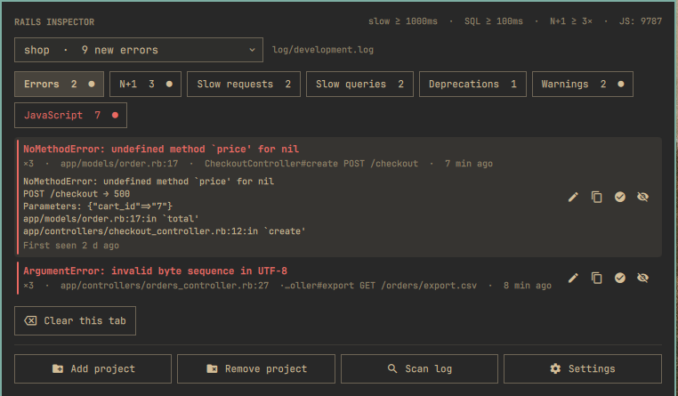
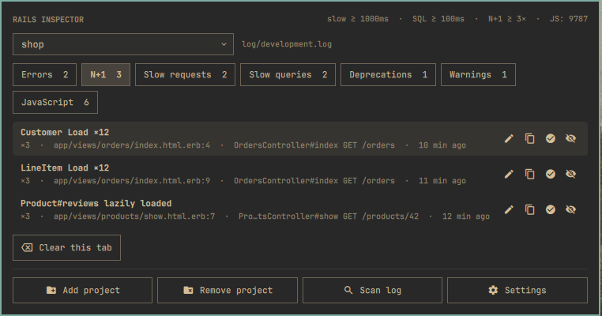
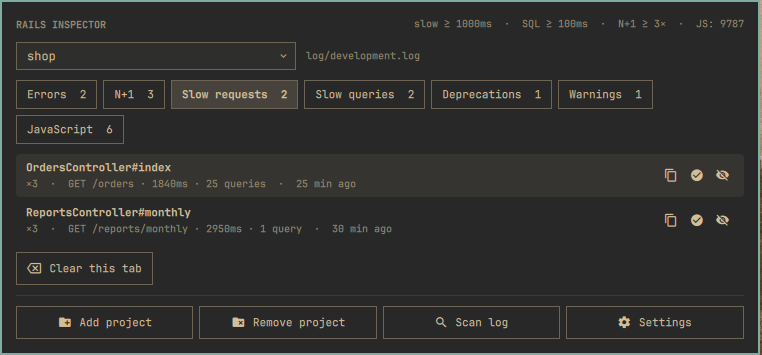
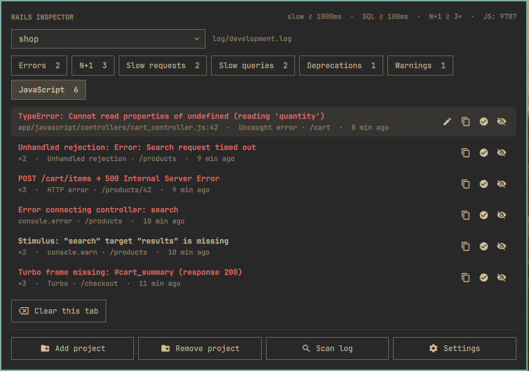
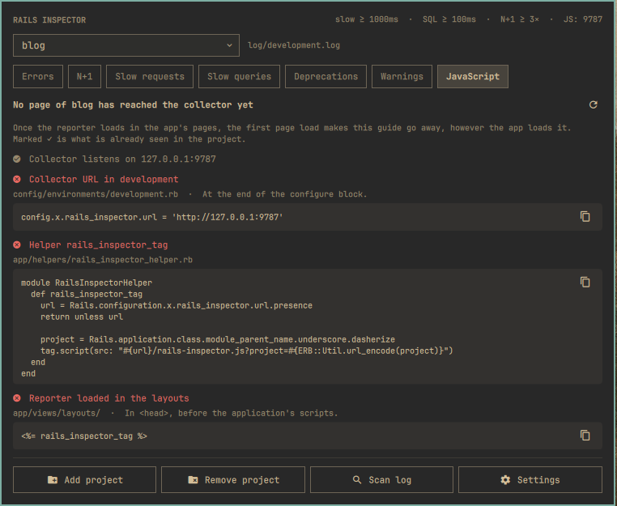
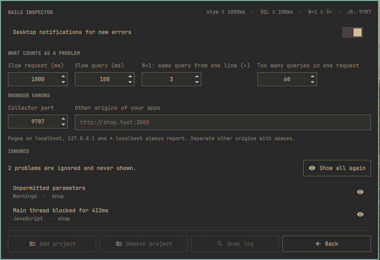

# Rails Inspector

An Omarchy plugin that shows what is wrong in your Rails applications during
development: exceptions, N+1 queries, slow requests and queries,
deprecations, warnings and, optionally, JavaScript errors from the browser.
Everything else stays in `log/development.log`.

The plugin reads the log the application already writes. There is no gem to
install and nothing to change in the application. Repeated problems from the
same place are shown once, with a count. New ones are marked until you open
the panel, and new errors also send a desktop notification.



## Install

```
omarchy plugin add https://github.com/MaNi4/omarchy-rails-inspector.git --enable
```

Open the panel from the bar (🐞), click **Add project** and choose the
directory of a Rails application. The plugin then follows its
`log/development.log` from that moment on. **Scan log** also goes through the
last 5 MB of it.

Requirements:

- Rails 7.0 or newer with the standard development log. Tested on Rails 7.0,
  7.1, 7.2, 8.0 and 8.1.
- Python 3.10 or newer, `python-gobject`, `notify-send` and `wl-copy`. All of
  them come with Omarchy.

## What it shows

| Tab | Contents |
|---|---|
| Errors | Exceptions, with the request, parameters and backtrace |
| N+1 | The same query run repeatedly from one line in one request, strict loading violations, requests with too many queries |
| Slow requests | Requests over the limit, with the time spent in views, Active Record and GC, and the slowest queries |
| Slow queries | Queries over the limit, with the line that ran them |
| Deprecations | Deprecation warnings, one entry per message |
| Warnings | Unpermitted parameters, CSRF problems, routing errors, `RecordNotFound`, Ruby warnings |
| JavaScript | Errors from the browser (optional, see below) |

Each entry can be opened in your editor at the right line (when the file is in
the project), copied, marked **Resolved** (it disappears until it happens
again) or **Ignored** (it no longer appears; you can bring it back in
**Settings**).

Keyboard: up and down move, left and right switch tabs, Enter opens the file,
`o` expands an entry, `y` copies, `x` resolves, `i` ignores, `p` picks a
project, `a` adds one, `s` scans the log, `c` opens the settings and Esc
closes.

## Screenshots

The pictures show made-up projects.

| N+1 queries | Slow requests |
|---|---|
|  |  |

| JavaScript errors | Setting up JavaScript errors |
|---|---|
|  |  |



## The log

The plugin understands the standard Rails development log. It cannot read
logs written by Lograge, a JSON formatter or another custom logger; in that
case the panel shows a note next to the project.

The line a query came from (`↳ app/models/order.rb:12`) is only in the log
with `config.active_record.verbose_query_logs`, which Rails turns on in
development by default.

When several requests or jobs run at the same time, their lines get mixed in
the log. Tag them with the request ID so that each query is assigned to the
right request:

```ruby
# config/environments/development.rb
config.log_tags = [ :request_id ]
```

## JavaScript errors (optional)

The plugin runs a small collector on `127.0.0.1:9787`. Pages of your
application load a script from it, which reports errors back. This needs a
few lines in the application. Until they are in place, the JavaScript tab
shows the same steps with the code to copy and a ✓ next to the steps that
are already done.

1. Set the collector's address for development:

   ```ruby
   # config/environments/development.rb
   config.x.rails_inspector.url = "http://127.0.0.1:9787"
   ```

2. Add a helper that loads the script:

   ```ruby
   # app/helpers/rails_inspector_helper.rb
   module RailsInspectorHelper
     def rails_inspector_tag
       url = Rails.configuration.x.rails_inspector.url.presence
       return unless url

       project = Rails.application.class.module_parent_name.underscore.dasherize
       tag.script(src: "#{url}/rails-inspector.js?project=#{ERB::Util.url_encode(project)}")
     end
   end
   ```

3. Call it in the `<head>` of every layout, before the application's own
   scripts:

   ```erb
   <%= rails_inspector_tag %>
   ```

   In Slim or Haml: `= rails_inspector_tag`.

4. If the application has a Content Security Policy, allow the collector for
   scripts and connections. With the policy built into Rails:

   ```ruby
   rails_inspector = Array(Rails.configuration.x.rails_inspector.url.presence)

   policy.script_src :self, *rails_inspector
   policy.connect_src :self, *rails_inspector
   ```

   With the `secure_headers` gem:

   ```ruby
   rails_inspector = Array(Rails.configuration.x.rails_inspector.url.presence)

   script_src: %w('self') + rails_inspector,
   connect_src: %w('self') + rails_inspector,
   ```

5. Restart the application.

The setting exists only in development, so in other environments the helper
adds nothing and the policy stays as it was.

The script sends the application's name (the module in
`config/application.rb`). The plugin matches it to the project by that name
or by the project's directory name, regardless of case, `-` and `_`, so
`MyShop`, `my_shop` and `my-shop` are the same. Once the first page has loaded, the
JavaScript tab switches from the steps to the errors.

It reports:

- uncaught errors and unhandled promise rejections;
- `console.error`, `console.warn` and failed `console.assert`;
- scripts, stylesheets and images that failed to load;
- HTTP errors (except 422) and network failures of `fetch` and XHR;
- Content Security Policy violations;
- deprecations and interventions reported by the browser;
- tasks blocking the page for 300 ms or more;
- Turbo problems: missing frames, failed requests, full page reloads and
  missing stream targets.

With esbuild source maps (`--sourcemap`, files `app/assets/builds/*.js.map`),
errors point to your source files and can be opened in the editor. Without
them they point into the bundle.

The collector accepts connections only on `127.0.0.1` and reports only from
pages on `localhost`, `127.0.0.1`, `*.localhost` and the addresses listed in
**Settings**.

## Settings

The cog button opens the settings:

- desktop notifications for new errors, on or off;
- limits for a slow request and a slow query in milliseconds, how many times
  the same query from one line counts as N+1, and how many queries in one
  request are too many;
- the collector's port, and other addresses of your applications besides
  localhost (for example `http://shop.test:3000`);
- the list of ignored problems, which can be brought back one by one or all
  at once.

Changes take effect immediately, including a new port.

## Remove

```
omarchy plugin remove mani4.rails-inspector
```

This is all that is needed. Two locations remain on disk so that the plugin
keeps its data if you install it again. Delete them if you do not need them:

- `~/.config/omarchy/extensions/rails-inspector.json` holds your projects,
  the settings and the list of ignored problems.
- `~/.local/state/mani4.rails-inspector/` holds one file per project with the
  problems found and their details (messages, requests, parameters,
  backtraces) and how far the log has been read.

If you set up JavaScript errors, the layouts will keep trying to load the
script, and the browser's console will report that it failed. Remove
`config.x.rails_inspector.url` from `development.rb` to stop that, or remove
all the lines from the steps above.

## Development

```
tests/run
```

runs all tests. They need `python3` and `node` and use only temporary
directories.

- Python tests cover the log parser, the collector and the rest of the
  background process (`bin/rails-inspector`, `lib/rails_inspector/`).
- `tests/run.js` covers the panel logic (`Model.js`) and runs the browser
  script in a simulated page.
- `tests/rails-logs/` contains real development logs from Rails 7.0 to 8.1,
  produced by a small application (`tests/rails-logs/app.rb`), with and
  without request tags. The tests check that the plugin finds the same
  problems in each. `tests/rails-logs/generate 8.2` adds a log from another
  Rails version (requires Docker).

The panel is `Panel.qml`, the shell service `Service.qml`. After changing a
QML file, run `omarchy restart shell` to load the new version.

## License

MIT
